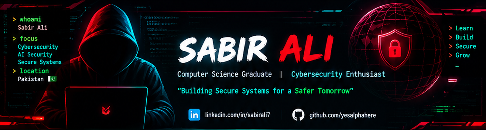
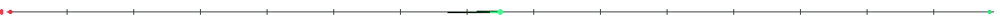
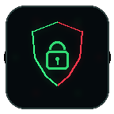

  
   
  
   
  
  
  

  

  <h2>👋 Hey, I'm Sabir Ali</h2>
  
<b>Computer Science Graduate · Cybersecurity Enthusiast · Curious Builder</b>

  
Exploring how applications, networks, connected devices, and AI systems can be tested, understood, and made more secure.

  
<i>Build with curiosity. Test with purpose. Improve with evidence.</i>

  
  
  
  

  

## 🔥 What I'm Into

<table>
  <tr>
    <td width="50%" valign="top">
      <h3>🔴 Web Application Security</h3>
      Access control, authentication and authorization, session handling, API security, and practical vulnerability assessment.
        
      
    </td>
    <td width="50%" valign="top">
      <h3>🟢 Network & System Security</h3>
      Network fundamentals, traffic analysis, Linux and Windows environments, service discovery, and system hardening.
        
      
    </td>
  </tr>
  <tr>
    <td width="50%" valign="top">
      <h3>🔌 IoT & Embedded Security</h3>
      ESP32 prototypes, connected-device workflows, firmware and communication concepts, and security-aware device design.
        
      
    </td>
    <td width="50%" valign="top">
      <h3>🤖 AI Security & Privacy</h3>
      Privacy-aware AI applications, biometric data protection, and the security challenges around intelligent systems.
        
      
    </td>
  </tr>
</table>

  

## ⚡ What I'm Doing Now

  
  
  

- **Hands-on web security:** practising access control, authentication, and related topics through PortSwigger Web Security Academy labs.
- **Build and document:** developing projects that connect software, computer vision, and connected devices.
- **Strengthen the fundamentals:** learning how systems behave, validating findings carefully, and recording useful technical notes.

  
  
  

## 🚀 Things I've Built

<table>
  <tr>
    <td width="50%" valign="top">
      
      <h3>📡 SentinelCam-ESP32</h3>
      An ESP32-CAM and motion-sensor prototype for capturing events, sending images through a cloud workflow, and delivering notifications.
        
      <b>Built around:</b> ESP32 · IoT · Apps Script · Event alerts
        
      <a href="https://github.com/yesalphahere/SentinelCam-ESP32">View project ↗</a>
    </td>
    <td width="50%" valign="top">
      
      <h3>🧠 AI-Based Facial Recognition Attendance System</h3>
      An academic project combining a web interface, backend APIs, a database, and computer-vision components to explore automated attendance and biometric-data handling.
        
      <b>Built around:</b> React · Django REST Framework · PostgreSQL · OpenCV
        
      <a href="https://github.com/yesalphahere?tab=repositories">Explore my repositories ↗</a>
    </td>
  </tr>
</table>

<i>More projects, experiments, and technical notes will appear here as I publish and document them.</i>

## 🧰 Tools I Use & Explore

  

<table>
  <tr>
    <td width="50%" valign="top">
      <h3>🌐 Web & API Testing</h3>
      
For inspecting requests and responses, exploring application behaviour, and practising tests in authorised labs.

      
      
      
      
      
      
    </td>
    <td width="50%" valign="top">
      <h3>🌍 Networks & Recon</h3>
      
For discovering services, understanding traffic, and examining network behaviour in controlled environments.

      
      
      
      
    </td>
  </tr>
  <tr>
    <td width="50%" valign="top">
      <h3>💻 Systems & Development</h3>
      
For scripting, source control, debugging, and setting up repeatable development or lab environments.

      
      
      
      
      
      
    </td>
    <td width="50%" valign="top">
      <h3>🧠 AI, Web & IoT Projects</h3>
      
For connecting interfaces, APIs, databases, computer-vision components, and devices.

      
      
      
      
      
      
    </td>
  </tr>
</table>

Tools are part of the workflow—not the result. I focus on understanding what a tool reveals, validating the output, and documenting what I learn.

  

## 🧭 How I Approach Security

  
  
  
  
  

- **Understand the scope** before testing.
- **Question assumptions** and inspect behaviour, not just appearance.
- **Verify evidence** before drawing conclusions.
- **Explain impact clearly** and keep useful notes.
- **Respect permission and privacy** in every security exercise.

## 📈 GitHub Activity

  
  
   
  
   
  

Stats and activity cards are provided by external services and may occasionally take time to load.

  

## 🤝 Let's Connect

If you're interested in practical cybersecurity, secure engineering, IoT, AI privacy, or sharing ideas and building useful projects, let's connect.

  
  
  

  
  
   
  <b>SECURITY&nbsp; / &nbsp;CURIOSITY&nbsp; / &nbsp;INNOVATION&nbsp; / &nbsp;IMPACT</b>

